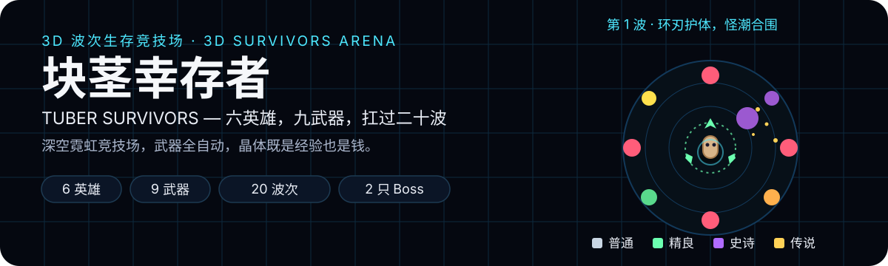
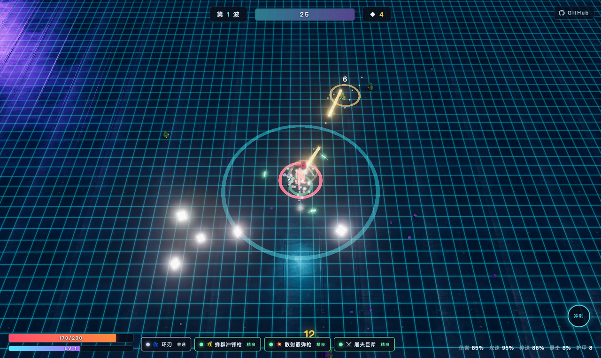

<p align="right"><a href="README.md">中文</a></p>

<p align="center">
  
</p>

<p align="center">
  <a href="https://xiaosang.cc/tuber-survivors/">▶ Play Online</a>
  ·
  <a href="https://github.com/holynova/tuber-survivors">GitHub Repository</a>
</p>

Tuber Survivors is a 3D top-down wave-based survivors roguelite in the spirit of Brotato: fight in a neon deep-space arena where weapons auto-aim and you focus on movement, rolling, and builds. Kills drop crystals — both XP and shop currency. Survive 20 waves and beat the final boss to win. Three.js + UnrealBloom glow + synthesized audio.

## Screenshot

<p align="center">
  
</p>

## How to Play

- **Move**: WASD or arrow keys; a 45° top-down camera follows you.
- **Roll**: Space — dash for 0.26s with 0.34s of invulnerability, 1.4s cooldown.
- **Shoot**: fully automatic targeting; ranged weapons aim at the nearest enemy within 9m, melee attacks pivot on your facing direction.
- **Pause**: Esc; **mute**: M.
- **Grow**: collect crystals to level up (pick 1 of 3 from 12 perks), and visit the shop after each wave (16 items; reroll, buy weapons, sell gear).
- **Win**: clear all 20 waves and kill the final boss; if your health hits zero, the run ends.

## Characters

6 heroes, each with a unique passive and starting weapon (numbers in `src/game/data.js`):

| Hero | Role | Unique Passive | Starting Weapon |
|:---|:---|:---|:---|
| **巴克·铁壁 (Buck Ironwall)** | Heavy tank (200 HP, 8 armor) | **荆棘震荡 (Thorn Shockwave)**: release a thorns shockwave every 6 hits taken | 环刃 (Orbit Blades) |
| **薇拉·疾风 (Vera Swiftwind)** | Evasive rapid-fire (move speed +40%, dodge 15%) | **残影 (Afterimage)**: first attack within 3s after a dash is a guaranteed crit (×2.2) | 蜂群冲锋枪 (Swarm SMG) |
| **卡尔·炮手 (Karl Gunner)** | Ranged suppression (ranged +45%, melee −45%) | **火力压制 (Fire Suppression)**: consecutive hits on the same target add +12% damage per stack (max 5) | 散射霰弹枪 (Scatter Shotgun) |
| **格罗什·狂战 (Grosh Berserker)** | Melee lifesteal (melee +45%) | **血怒 (Bloodrage)**: below 50% HP, damage +60% and lifesteal +15% | 屠夫巨斧 (Butcher Cleaver) |
| **缇娜·工匠 (Tina Artisan)** | Turret emplacement (pickup +20%) | **机械随从 (Mechanical Retinue)**: start with 1 turret, turret damage +60%, max 2 turrets | 哨戒炮塔 (Sentry Turret) |
| **梅琳·奥术 (Meryl Arcane)** | Elemental mage (elemental +50%, crit +10%) | **过载电容 (Overload Capacitor)**: lightning chains +2 targets, elemental hits have a 15% chance to stun for 0.6s | 电弧线圈 (Arc Coil) |

## Weapons

9 weapons, max 6 at once, in four tiers — 普通 Common / 精良 Fine / 史诗 Epic / 传说 Legendary — with damage multipliers of 1 / 1.4 / 1.85 / 2.4:

- **铆钉手枪 (Rivet Pistol)**: fast single shots, the all-rounder; **散射霰弹枪 (Scatter Shotgun)**: 6-pellet spread with heavy knockback; **蜂群冲锋枪 (Swarm SMG)**: blistering 0.11s fire rate.
- **屠夫巨斧 (Butcher Cleaver)**: 120° arc AoE in front of you; **环刃 (Orbit Blades)**: 3 blades permanently circling and cutting; **迫击炮 (Mortar)**: arcing explosions + burning ground.
- **电弧线圈 (Arc Coil)**: chains to 3 targets; **棱镜光束 (Prism Beam)**: sustained piercing laser; **哨戒炮塔 (Sentry Turret)**: deploy an auto-turret (lasts 9s).

## Enemies & Bosses

- **5 enemy types**: 啃食者 (Gnawer, from wave 1), 壮肉 (Brute, wave 3), 孢子喷吐者 (Spore Spitter, wave 4, ranged), 冲锋兽 (Charger, wave 6, lunges after a 0.7s wind-up), 自爆虫 (Exploder, wave 8, detonates up close); elites appear from wave 8 (HP ×2.6).
- **2 bosses**: **菌王 (Brood King)** (850 HP, stomp + charge + summon, appears once each on waves 5 / 10 / 15) and **块茎暴君 (Tuber Tyrant)** (2,600 HP, the wave-20 final fight, 4 skills: stomp, charge, summon, full-screen bullet hell).
- Wave duration starts at 22s for wave 1 and grows by 2s per wave, capped at 45s; spawn budget cap 120, on-screen enemy cap 110.

## Run Locally

```bash
git clone https://github.com/holynova/tuber-survivors.git
cd tuber-survivors
npm install
npm run dev      # dev server at http://localhost:5173, with HMR
npm run build    # production build into docs/
npm run preview  # preview the production build locally
```

## Tech

- Three.js 0.186.1 + Vite 8.3.1; EffectComposer + UnrealBloomPass neon glow (half resolution).
- A custom particle system (3,600-particle pool, zero GC) and object pooling (enemy InstancedMesh, projectiles, turrets, orbit blades, damage numbers); circle-circle collision on the XZ plane + spatial hashing.
- WebAudio synthesized sound effects (gunfire, slashes, explosions, hits) — no external audio files.
- Character/enemy/weapon models are CC0 low-poly assets (Quaternius + Kenney, GLB files in `public/models/`), falling back to procedural geometry if loading fails.

```
index.html              Entry (title / character select / HUD / upgrades / shop / results)
src/main.js             Startup: Engine + Game + UI
src/game/game.js       Main loop: waves, shop, upgrades, results
src/game/data.js        Data tables: heroes / weapons / enemies / bosses / items / upgrades
src/game/weapons.js     9 weapon systems (tiers, ballistics, effects)
src/game/enemies.js     Enemy pools and behaviors (chase / charge / ranged / explode / bosses)
src/game/waves.js       Wave director (budget, spawn pacing, boss waves)
src/game/player.js      Player: movement, roll invulnerability, passives
src/core/engine.js      Three.js renderer, camera, bloom post-processing
src/core/particles.js   Particle system (3,600 pool)
src/core/audio.js       WebAudio synthesized sound effects
```
