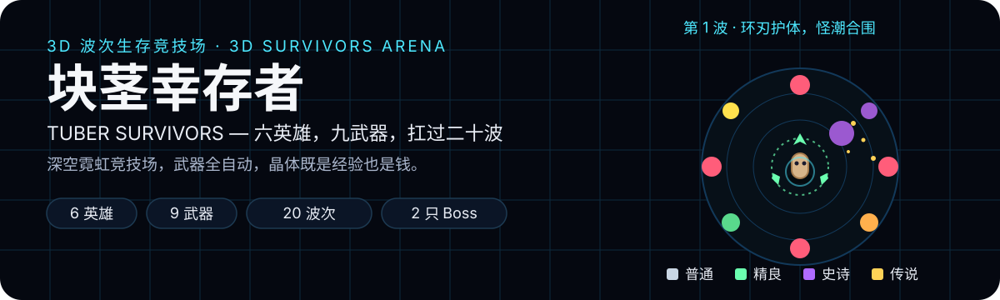
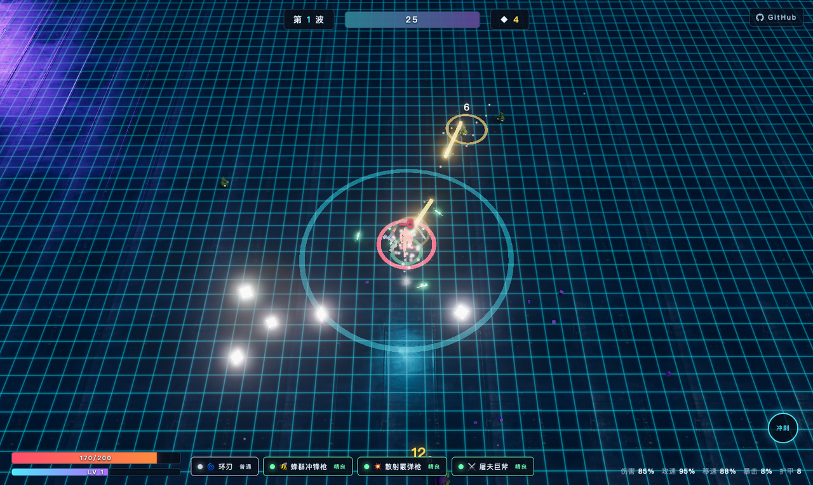

<p align="center">
  
</p>

<p align="center">
  <a href="https://xiaosang.cc/tuber-survivors/">▶ 在线玩 Play Online</a>
  ·
  <a href="https://github.com/holynova/tuber-survivors">GitHub 仓库</a>
</p>

块茎幸存者是一款 3D 俯视角波次生存竞技场 Roguelite（致敬《土豆兄弟》）：在深空霓虹竞技场里操纵土豆战士，武器全自动索敌，你只管走位、翻滚与构筑。击杀掉落晶体，晶体既是经验也是波间商店的货币。撑过 20 波、击败最终 Boss 即通关。Three.js + UnrealBloom 辉光 + 程序化音效。

Tuber Survivors is a 3D top-down wave-based survivors roguelite in the spirit of Brotato: fight in a neon deep-space arena where weapons auto-aim and you focus on movement, rolling, and builds. Kills drop crystals — both XP and shop currency. Survive 20 waves and beat the final boss to win. Three.js + UnrealBloom glow + synthesized audio.

## 截图 / Screenshots

<p align="center">
  
</p>

## 玩法 / How to Play

- **移动**：WASD 或方向键；45° 俯视角镜头跟随。
- **翻滚**：空格，冲刺 0.26 秒并附带 0.34 秒无敌，冷却 1.4 秒。
- **射击**：全自动索敌；远程武器瞄准 9 米内最近敌人，近战以朝向为轴。
- **暂停**：Esc；**静音**：M。
- **成长**：拾取晶体升级（12 种词条三选一），每波结束进商店（16 种道具，可刷新、买武器、卖装备）。
- **通关**：打满 20 波并击杀最终 Boss；血量归零则失败。

## 英雄 / Characters

6 名英雄，各带专属被动与初始武器（数值见 `src/game/data.js`）：

| 英雄 | 定位 | 专属被动 | 初始武器 |
|:---|:---|:---|:---|
| **巴克·铁壁** | 重装坦克（生命 200，护甲 8） | **荆棘震荡**：每受击 6 次释放反伤冲击波 | 环刃 |
| **薇拉·疾风** | 闪避速射（移速 +40%，闪避 15%） | **残影**：冲刺后 3 秒内首次攻击必暴击（×2.2） | 蜂群冲锋枪 |
| **卡尔·炮手** | 远程压制（远程 +45%，近战 -45%） | **火力压制**：连中同一目标每层 +12% 伤害（最多 5 层） | 散射霰弹枪 |
| **格罗什·狂战** | 近战吸血（近战 +45%） | **血怒**：生命低于 50% 时伤害 +60%、吸血 +15% | 屠夫巨斧 |
| **缇娜·工匠** | 炮塔阵地（拾取 +20%） | **机械随从**：开局自带 1 座炮塔，炮塔伤害 +60%，上限 2 座 | 哨戒炮塔 |
| **梅琳·奥术** | 元素法师（元素 +50%，暴击 +10%） | **过载电容**：电系链跳 +2，元素命中 15% 概率眩晕 0.6 秒 | 电弧线圈 |

## 武器 / Weapons

9 种武器，最多同时持有 6 把；分普通 / 精良 / 史诗 / 传说四档，伤害倍率 1 / 1.4 / 1.85 / 2.4：

- **铆钉手枪**：高速单发，万金油；**散射霰弹枪**：6 发扇面，强击退；**蜂群冲锋枪**：0.11 秒超高射速。
- **屠夫巨斧**：身前 120° 圆弧 AOE；**环刃**：3 片刀刃常驻环绕切割；**迫击炮**：抛物线爆炸 + 地面灼烧。
- **电弧线圈**：链跳 3 个目标；**棱镜光束**：持续穿透激光；**哨戒炮塔**：部署自动炮台（存在 9 秒）。

## 敌人与 Boss / Enemies & Bosses

- **5 种敌人**：啃食者（第 1 波起）、壮肉（第 3 波）、孢子喷吐者（第 4 波，远程）、冲锋兽（第 6 波，0.7 秒蓄力后突刺）、自爆虫（第 8 波，近身爆裂）；第 8 波起出现精英（血量 ×2.6）。
- **2 只 Boss**：**菌王**（850 HP，践踏 + 冲撞 + 召唤，第 5 / 10 / 15 波各来一次）、**块茎暴君**（2600 HP，第 20 波最终战，4 技能：践踏、冲撞、召唤、全屏弹幕）。
- 波次时长第 1 波 22 秒、逐波 +2 秒，上限 45 秒；刷怪预算上限 120，同屏敌人上限 110。

## 本地运行 / Run Locally

```bash
git clone https://github.com/holynova/tuber-survivors.git
cd tuber-survivors
npm install
npm run dev      # 开发服务 http://localhost:5173，支持 HMR
npm run build    # 生产打包到 docs/
npm run preview  # 本地预览打包产物
```

## 技术 / Tech

- Three.js 0.186.1 + Vite 8.3.1；EffectComposer + UnrealBloomPass 霓虹辉光（半分辨率）。
- 自研粒子系统（3600 粒子池，零 GC）与对象池（敌人 InstancedMesh、弹丸、炮塔、环刃、飘字）；XZ 平面圆-圆碰撞 + 空间哈希。
- WebAudio 程序化合成音效（枪火、挥砍、爆炸、受击），无外部音频文件。
- 角色/敌人/武器模型为 CC0 低模（Quaternius + Kenney，GLB 在 `public/models/`），加载失败时回退程序化几何体。

```
index.html              入口（标题 / 选角 / HUD / 升级 / 商店 / 结算）
src/main.js             启动：Engine + Game + UI
src/game/game.js       主循环：波次、商店、升级、结算
src/game/data.js        数据表：英雄 / 武器 / 敌人 / Boss / 道具 / 升级
src/game/weapons.js     9 武器系统（品阶、弹道、特效）
src/game/enemies.js     敌人池与行为（追击 / 冲锋 / 远程 / 自爆 / Boss）
src/game/waves.js       波次导演（预算、刷怪节奏、Boss 波）
src/game/player.js      玩家：移动、翻滚无敌、被动
src/core/engine.js      Three.js 渲染器、镜头、辉光后期
src/core/particles.js   粒子系统（3600 池）
src/core/audio.js       WebAudio 程序化音效
```

## English

**Tuber Survivors** is a 3D top-down wave-based survivors roguelite in the spirit of Brotato. Weapons auto-aim — you move, roll, and build.

- **Characters**: 6 heroes with distinct passives — Buck (thorns tank), Vera (post-dash guaranteed crit), Karl (stacking suppression), Grosh (low-HP bloodrage), Tina (free turret), Meryl (chain lightning + stun).
- **Weapons**: 9 weapons, max 6 at once, in 4 tiers (damage ×1 / ×1.4 / ×1.85 / ×2.4) — pistol, shotgun, SMG, cleaver, orbit blades, mortar, chain coil, prism beam, turret.
- **Progression**: 12 upgrade perks (pick 1 of 3 on level-up), 16 shop items between waves. Crystals are both XP and currency.
- **Waves**: 20 waves, 22s growing to 45s; 5 enemy types plus elites from wave 8; Brood (850 HP) on waves 5/10/15, the Tyrant (2,600 HP) as the wave-20 final boss.
- **Dash**: Space rolls for 0.26s with 0.34s invulnerability, 1.4s cooldown.
- **Tech**: Three.js 0.186.1 + Vite 8.3.1, UnrealBloom post-processing, custom 3,600-particle system, WebAudio synthesized SFX, CC0 low-poly GLB models.

## 许可 / License

ISC，见 `package.json` 声明。
